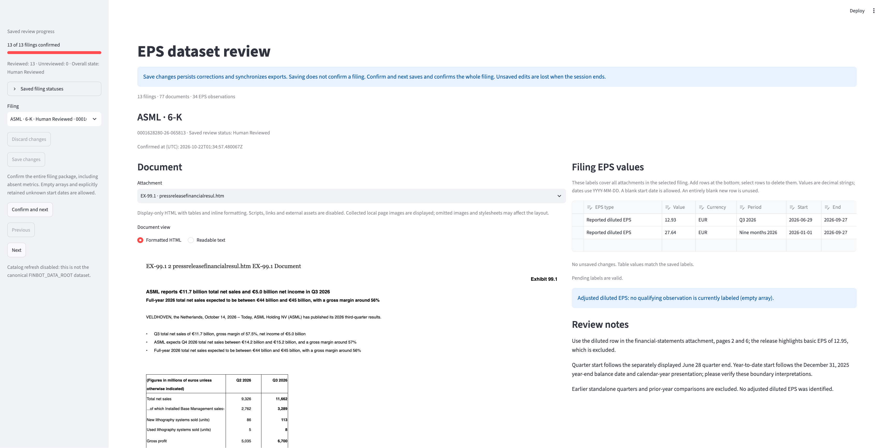

# finbot-filing-evals

This package provides a local Streamlit UI for inspecting original SEC documents
collected by `finbot-filings`, correcting reported/adjusted diluted EPS labels,
and confirming a golden dataset. A separate CLI evaluates EPS extractors against
that human-reviewed dataset and compares saved runs.

**Latest evaluation:** GPT-6 Luna through the OpenAI API, using prompt v6, matched
all 83 fiscal targets across the 50 reviewed filings (50/50 exact; 100% F1).
This follow-up also evaluated HON's 34-image filing after removing a Bedrock-only
image cap from OpenAI input preparation. The 50-case sample was used during prompt
development, so this is not held-out accuracy. Earlier, Luna v4 matched all 20
targets in each of three runs on the original 13 filings. See the
[experiment report](docs/MODEL_EXPERIMENT_REPORT.md) for results, run IDs, token
usage, runtime, cache effects and estimated costs. Nova 2 Lite through Bedrock
remains the historical baseline. Runs freeze reviewed inputs and write Markdown,
JSON and Parquet reports. Raw/cleaned HTML and earlier prompt experiments remain
available.



ASML filing review in Firefox, captured from a disposable dataset copy.

The review UI edits and confirms the filing labels; evaluation is a separate,
explicit CLI workflow that can make paid Bedrock, OpenAI or Anthropic calls.
Opening the review UI never invokes a model. See the [review QA checklist](docs/REVIEW_QA.md)
for the current operating workflow.

## EPS extraction evaluation

The proposed expansion from 13 reviewed filings to 50 is documented in
[the sample selection plan](docs/EVALUATION_SAMPLE_50.md), with exact S3
accessions and object membership in [the selection manifest](docs/EVALUATION_SAMPLE_50.json).
It retains the original 13 and selects 37 new issuers, including HON's image-heavy
10-Q and four additional foreign 6-K filers. These sources have now been imported
into a separate **50-case review bundle** at
`$FINBOT_DATA_ROOT/filing-evals/golden/earnings-eps-50-v1`:
**50 human-reviewed cases**, with 104 HTML files and 85 original images. The
37 additions contain 117 source-grounded EPS observations; the original 13
reviewed cases were preserved exactly.
The combined bundle has 151 source observations, projecting to 83 fiscal targets
after 68 cumulative/YTD exclusions. No paid extractor/provider calls were used
for annotation. See [the labeling handoff](docs/SAMPLE_50_LABELING.md) and
[the import handoff](docs/SAMPLE_50_IMPORT.md) for verification and provenance.

The completed sample-50 v6 run scored **83/83 targets correct**, with no
extraction errors and all 50 filings exact. The v6 prompt clarifies that reported
EPS uses the explicitly disclosed total when both continuing-operations and
total diluted EPS are shown. Run artifacts are stored under
`$FINBOT_DATA_ROOT/filing-evals/runs/20261023T145725Z-9ff8c84b/`.

The sample-50 v4 run is the baseline comparison. Its 47 exact filings included
two continuing-operations values where the reviewed targets use total EPS; HON
failed locally because an AWS Bedrock image limit was also applied to OpenAI.
After that provider-specific limit was fixed, v6 processed HON's 34 images.
Among v4's 49 returned predictions, 47 were unchanged in v6; IBM and AT&T now
match the reviewed total EPS. The sample was used for prompt development, so
these results are not held-out accuracy.

Repeat the GPT-6 Luna v4 baseline against all 50 reviewed filings from this repo:

```bash
export FINBOT_DATA_ROOT=/Users/ilan/workspace/finbot/data
.venv/bin/finbot-eval-eps run \
  --dataset-root "$FINBOT_DATA_ROOT/filing-evals/golden/earnings-eps-50-v1" \
  --config configs/openai-luna-6-prompt-v4-sample-50.json
```

To compare the targeted reported-EPS scope clarification while holding the
model, inputs, settings and scoring fixed, use the v6 prompt config:

```bash
.venv/bin/finbot-eval-eps run \
  --dataset-root "$FINBOT_DATA_ROOT/filing-evals/golden/earnings-eps-50-v1" \
  --config configs/openai-luna-6-prompt-v6-sample-50.json
```

Export `OPENAI_API_KEY` in the same shell before running. This command makes
paid OpenAI API calls and saves the run under
`$FINBOT_DATA_ROOT/filing-evals/runs/`.

Open that bundle in the labeling UI with an explicit path:

```bash
.venv/bin/python -m streamlit run scripts/review_eps.py \
  --server.address 127.0.0.1 --server.port 8502 -- \
  --dataset-root /Users/ilan/workspace/finbot/data/filing-evals/golden/earnings-eps-50-v1
```

Select any filing to inspect its sources and labels, or **HON** for the 34-image
10-Q. The original 13-case bundle, default UI path and evaluation configs are preserved.
The new bundle requires the explicit path above; automatic catalog refresh is
disabled for this noncanonical path. After labeling sessions, refresh it with:

```bash
../finbot-catalog/.venv/bin/python ../finbot-catalog/scripts/build_catalog.py \
  --data-root /Users/ilan/workspace/finbot/data
```

Run commands from this repository root. Install the optional evaluation and
Bedrock dependencies in this package's own Python >=3.12 environment:

```bash
.venv/bin/python -m pip install -e '.[dev,review,eval,bedrock]'
export FINBOT_DATA_ROOT=/Users/ilan/workspace/finbot/data
.venv/bin/finbot-eval-eps run --config configs/bedrock-nova-2-lite-prompt-v4.json
```

The last command makes **paid Bedrock inference calls** using the normal boto3
credential chain, including `AWS_PROFILE` when set. It never creates AWS resources,
changes IAM, enables models, downloads documents or alters golden data. Configure
AWS credentials and model permissions before running it. Tests do not use live AWS.
No credentials belong in config files, prompts, outputs or command arguments.
The package does not load `.env` files.

The Nova config selects `us.amazon.nova-2-lite-v1:0` through Bedrock Runtime
Converse in `us-east-1`, with US geographic routing, 4096 maximum output tokens
and the model's other defaults (extended thinking is off). The recommended config
uses `prompts/eps-v4.txt`, the fiscal-period schema, HTML-derived plain text and
original images. The separate Luna config still references `prompts/eps-v2.txt`;
model comparisons must align prompts explicitly. Nova uses
`settings.output_mode: "tool"` to request the EPS
object through a single forced `submit_eps` response. No external tool is executed
and there is no second model call; its arguments are the extraction payload and
undergo the usual validation. Your identity needs access to this model/profile
and `bedrock:InvokeModel`; organization policies and model access can also apply.
Consult the current [Nova 2 Lite model card](https://docs.aws.amazon.com/bedrock/latest/userguide/model-card-amazon-nova-2-lite.html)
for availability, permissions and pricing. Region and optional `aws_profile` are
explicit config fields; this workflow performs no automatic AWS setup.

The separate Luna config remains available once AWS grants account access:

```bash
.venv/bin/finbot-eval-eps run --config configs/bedrock-luna.json
```

Luna uses `us.openai.gpt-6-luna`, the same region and output budget, and its own
pricing table. Its existing text-response mode remains unchanged. An
`AccessDeniedException` saying the model is not available for
the account and to contact AWS Sales is an account-level restriction. See
[AWS troubleshooting](https://repost.aws/knowledge-center/bedrock-access-denied-exception).
The Nova configuration is independent of that request. Neither configuration
automatically enables models or accepts provider agreements.

Nova's pinned US standard rates were verified against AWS Price List API catalog
version `20261016210806`, effective 2026-10-01 and published 2026-10-16: input
$0.33, output $2.75, cache-read $0.0825 and cache-write $0 per million tokens.
The four `us-east-1` SKUs are `FY8T82UUN7VZR55K`, `DY69Q8C3F88CHA2Q`,
`NZS2WHKW9KB4K2QH` and `RUKFVY37BYV339ZG`, respectively. These are the US rates,
not the global-routing rates. Nova's config uses multipliers of 1 throughout its
1M-token context window; it does not inherit Luna's long-context surcharge.
Rates remain estimates based on provider-reported usage and the pinned table.

### Reference baseline and experiment results

The historical Nova reference is [configs/bedrock-nova-2-lite-prompt-v4.json](configs/bedrock-nova-2-lite-prompt-v4.json)
with [prompts/eps-v4.txt](prompts/eps-v4.txt). Omitted `html_input` means
`plain_text`; original collected images are also sent. The prompt targets one
current fiscal quarter or complete fiscal year, excludes partial-year multiquarter
aggregations, and retains reported/adjusted EPS and explicitly stated currencies.
Prompt version v4 still uses the `earnings_eps.fiscal.v2` label contract.

Observed results on the same 13 reviewed filings / 20 quarterly-or-annual targets:

| Input with v4 prompt | F1 | Exact filings | Input tokens | Runtime | Estimated cost per 13-filing run |
| --- | --- | --- | --- | --- | --- |
| Plain text, run A | 97.6% | 12/13 | 397,473 | 48.52 s | $0.1349 |
| Plain text, repeat B | 90.0% | 10/13 | 397,473 | 48.40 s | $0.1348 |
| Raw HTML | 65.0% | 4/13 | 4,173,479* | 339.73 s | $1.3816* |
| Cleaned HTML | 78.0% | 8/13 | 997,809 | 78.10 s | $0.3341 |

*Raw HTML usage/cost is incomplete: 12/13 filings reported usage. All costs are
estimates from pinned rates and provider usage, not confirmed AWS billing.
The two plain-text runs used identical data, prompt, model settings and code but
returned different answers. Raw and cleaned HTML each have one measured run;
these results support the current baseline choice, not a claim of guaranteed
accuracy or performance on unseen filings. The same small sample was used for
prompt tuning, with no held-out validation.

### 50-filing Luna follow-up

The follow-up used the 50 human-reviewed filings and the same frozen dataset
revision for both runs. V4 produced 80 correct targets, two incorrect values and
one missing target (F1 97.0%; 47/50 exact). The two incorrect reported EPS values
were IBM and AT&T: both selected continuing-operations EPS rather than the
explicitly reported total. HON did not reach OpenAI because local input
preparation incorrectly enforced Bedrock's 20-image limit. V4's known cost was
$0.15229, incomplete because HON had no provider usage.

With that OpenAI image check corrected and the new v6 scope clarification, Luna
returned all 83 targets correctly (100% F1; 50/50 exact) with complete estimated
cost of $0.15944 and 164.13 seconds of extractor time. HON's reported EPS was
correct from its 34-image filing. Across the 49 v4 predictions that were
returned, 47 stayed identical; only IBM and AT&T changed, both to the reviewed
total EPS. This is consistent with the prompt clarification resolving those two
errors, while the HON improvement came from the separate provider-limit fix.
These are single runs on a sample used for prompt development, not held-out
validation. Full artifacts are under `$FINBOT_DATA_ROOT/filing-evals/runs/`:
`20261023T135326Z-0126d7df` (v4) and `20261023T145725Z-9ff8c84b` (v6).

See the [full experiment report](docs/MODEL_EXPERIMENT_REPORT.md) for subsequent
model comparisons, including three perfect Luna runs and perfect Sonnet, Kimi
and Haiku runs. Its cost tables distinguish cache hits, partial usage and
post-hoc estimates. The [earlier Nova record](docs/EVALUATION_EXPERIMENTS.md)
retains detailed prompt/input comparisons and failure analysis.
The older `configs/bedrock-nova-2-lite.json` still selects the **v2 prompt**;
its filename has been retained for reproducibility and does not select v4.

### Available configurations and input modes

| Config under `configs/` | Prompt | HTML input | Role |
| --- | --- | --- | --- |
| `bedrock-nova-2-lite-prompt-v4.json` | v4 | Plain text | Historical reference baseline |
| `bedrock-nova-2-lite-prompt-v4-raw-html.json` | v4 | Entire HTML | Evaluated experiment; higher observed cost/lower F1 |
| `bedrock-nova-2-lite-prompt-v4-cleaned-html.json` | v4 | Cleaned HTML | Evaluated experiment; did not outperform plain text |
| `bedrock-nova-2-lite-prompt-v5.json` | v5 | Plain text | Evaluated prompt experiment; no observed improvement |
| `bedrock-nova-2-lite-prompt-v3.json` | v3 | Plain text | Historical prompt experiment |
| `bedrock-nova-2-lite.json` | v2 | Plain text | Historical fiscal v2 baseline |
| `bedrock-luna.json` | v2 | Plain text | Separate model config; requires account access |
| `bedrock-claude-sonnet-4-6-prompt-v4.json` | v4 | Plain text | Evaluated: 100% F1, 13/13 exact filings |
| `bedrock-kimi-k3-prompt-v4.json` | v4 | Plain text | Evaluated: 100% F1, 13/13 exact filings |
| `bedrock-mistral-large-3-prompt-v4.json` | v4 | Plain text | Evaluated: all requests/output parsing failed |
| `bedrock-qwen3-vl-235b-prompt-v4.json` | v4 | Plain text | Evaluated: 78.8% F1, 9/13 exact filings |
| `openai-luna-6-prompt-v4.json` | v4 | Plain text | Direct OpenAI Responses; requires OPENAI_API_KEY |
| `openai-luna-6-prompt-v4-sample-50.json` | v4 | Plain text | 50-filing baseline run |
| `openai-luna-6-prompt-v6-sample-50.json` | v6 | Plain text | 50-filing follow-up; total diluted EPS clarification |
| `anthropic-haiku-5-5-prompt-v4.json` | v4 | Plain text | Direct Anthropic Messages; requires ANTHROPIC_API_KEY |

### Direct OpenAI and Anthropic APIs

Install the optional direct SDKs in this repository's environment:

```bash
.venv/bin/python -m pip install -e '.[dev,review,eval,bedrock,openai,anthropic]'
```

The maintained credential template is [.env.example](.env.example). Put your real
keys in the ignored `.env` file at this repository root, preserving any existing
settings. Use the variable names below; configs contain no keys:

```dotenv
FINBOT_DATA_ROOT=/Users/ilan/workspace/finbot/data
OPENAI_API_KEY=your-openai-key
ANTHROPIC_API_KEY=your-anthropic-key
# Only for an Anthropic key that is not scoped to a workspace:
# ANTHROPIC_WORKSPACE_ID=your-workspace-id
```

The app and CLI deliberately do not parse `.env`. Export its values into the
same shell before running the explicit **paid inference** commands:

```bash
set -a
source .env
set +a

.venv/bin/finbot-eval-eps run --config configs/openai-luna-6-prompt-v4.json
.venv/bin/finbot-eval-eps run --config configs/anthropic-haiku-5-5-prompt-v4.json
```

Observed direct-provider results are recorded in the
[experiment report](docs/MODEL_EXPERIMENT_REPORT.md): Luna matched 13/13 filings
on three runs; Haiku matched 13/13 after the unsupported-speed fix.

Only the selected provider's key is required. Missing/blank keys stop before
inference with the variable name in the error. Offline `--predictions` scoring
requires neither keys nor a provider client. Both providers reuse the same reviewed
snapshots, original images, HTML input modes and fiscal v2 scoring. The original
13-filing experiments use v4; the 50-filing follow-up compares v4 with v6.
Legacy v1 labels are not supported by these direct adapters. Use the existing
`compare` command with a saved fiscal v2 run.

OpenAI uses `gpt-6-luna` on the Responses API with strict JSON-schema output,
`store: false`, disabled input truncation, Standard processing, and implicit
30-minute prompt caching. Anthropic uses `claude-haiku-5-5` on Messages with
`output_config.format`, adaptive thinking, the Standard tier and explicit global
inference geography. The two configs use 4096 maximum output tokens, medium
reasoning/effort and a 120-second SDK timeout per attempt. SDK retries allow at
most two attempts; there are no model-based repairs, automatic continuation calls,
web searches or tool execution. Native endpoints are pinned; the adapters do not
honor OPENAI_BASE_URL or ANTHROPIC_BASE_URL overrides. The SDKs are imported lazily.
No live direct-provider access or accuracy is claimed by offline tests.
Haiku 5.5 rejects the `speed` parameter, including `speed: "standard"`; the adapter
omits it and uses the model's default speed. If all filings immediately return
HTTP 400 without usage, inspect the report before rerunning. Known unsupported-speed,
workspace-scope and credit-balance failures include static diagnostic hints; a
valid provider request ID is retained for support. Raw error messages/headers are
never written. Set ANTHROPIC_WORKSPACE_ID only when your key requires a workspace.

The source fiscal schema contains conditional keywords that OpenAI structured
outputs do not support. A deterministic transport schema replaces those rules
with quarterly/annual unions, including quarter 1–4 versus annual null. Anthropic
does not support numerical bounds, so its fiscal-year bounds are described in the
transport schema and still checked locally. Each request freezes the exact
`output_schema` and compiler version alongside the unchanged original schema.
The full original schema, duplicate checks and exact scoring remain authoritative.
Refusals, incomplete responses, unexpected blocks, fenced JSON, wrong field names
and invalid observations remain extraction errors, even with billed token usage.

Both configs pin public global Standard rates checked on 2026-10-22: $0.10 input,
$0.50 output, $0.01 cache-read and $0.125 cache-write per million tokens. Luna's
30-minute cache-write price and Haiku's 5-minute cache-write price happen to match;
the adapters do not request explicit Anthropic caching. Luna applies 2x input/cache
and 1.5x output rates above 272,000 prompt tokens. Haiku applies 5x all token rates
above 100,000 prompt tokens. Thresholds apply separately per request and include
cache reads/writes. See [Luna pricing](https://developers.openai.com/api/docs/models/gpt-6-luna)
and [Haiku pricing](https://platform.claude.com/docs/en/models/haiku-5-5/overview).
Global routing differs from the US profiles in the Bedrock configs.

Native successful API bodies are saved as `responses/*.provider.json`; request
headers and SDK exception bodies/messages are not saved. Normalized usage retains
`providerUsage` plus the existing `inputTokens`, `outputTokens` and cache counters.
OpenAI's total input count includes cached/written tokens, so those are separated
before applying rates; Anthropic reports them separately already. Reasoning tokens
are included in billed output, without adding them twice. Reports currently show
ordinary input tokens; inspect cache counters/native usage for total prompt size.
Missing usage leaves costs unknown. Known usage/cost survives output-validation
failures. Estimates exclude unknown retry charges and do not establish billing.
The shared source-size check limits total source material to 64 MiB. The
20-image, 3.75-MB-per-image and 8,000-pixel dimension checks apply to Bedrock
requests; OpenAI input preparation does not apply those Bedrock-specific limits.
Each provider can still reject requests that exceed its own current limits.

### Alternative model experiments

Four configs reuse the existing Converse adapter, unchanged v4 prompt, original
images, fiscal v2 targets and exact scoring. All use `us-east-1`, 4096 maximum
output tokens and a 120-second socket read timeout. Sonnet 4.6 and Kimi K3 use US
inference profiles; Mistral Large 3 and Qwen3 VL use direct regional model IDs.
Read-only account checks on 2026-10-22 returned available authorization,
entitlement, agreement and regional status for all four. These are account flags,
not invocation tests or verification of the local CLI identity's IAM permissions.
Subsequent operator runs are summarized in the
[experiment report](docs/MODEL_EXPERIMENT_REPORT.md), including provider and
output-validation failures.

Sonnet uses the same forced `submit_eps` tool mode as Nova. The other three use
the adapter's strict JSON text mode because named forced-tool support was not
established for them. Fenced JSON, extra prose and malformed outputs remain
errors; there is no fallback, repair or second call. Comparisons therefore measure
the complete extractor configuration, including response mode and provider-default
reasoning. Kimi K3 reasons by default at maximum effort; a 4096-token output budget
can be exhausted by reasoning. A later budget change should use a new config and
be recorded as another experiment. Its documented multi-turn Converse limitations
do not apply to this single-turn workflow; HTML is sent as text, not a document
block. See the [Kimi model card](https://docs.aws.amazon.com/bedrock/latest/userguide/model-card-moonshot-ai-kimi-k3.html).

Run any command explicitly when ready for **paid inference**; each evaluates the
entire reviewed bundle and writes a separate run directory:

```bash
.venv/bin/finbot-eval-eps run --config configs/bedrock-claude-sonnet-4-6-prompt-v4.json
.venv/bin/finbot-eval-eps run --config configs/bedrock-kimi-k3-prompt-v4.json
.venv/bin/finbot-eval-eps run --config configs/bedrock-mistral-large-3-prompt-v4.json
.venv/bin/finbot-eval-eps run --config configs/bedrock-qwen3-vl-235b-prompt-v4.json
.venv/bin/finbot-eval-eps compare /path/to/saved-v4-nova-run /path/to/new-model-run
```

Inspect errors before interpreting scores. Provider context/image limits can differ;
the adapter never drops attachments or truncates inputs to make a request fit.
Use the same reviewed revision as the Nova run; comparison refuses changed targets.
Token counts and runtime are reported for every candidate when available.

Only Kimi has a complete pinned pricing table: US standard input/output/cache-read/
30-minute cache-write rates are $3.30/$16.50/$0.33/$4.125 per million tokens, with
no long-context multiplier. AWS Price List catalog `20261016210806`, effective
2026-10-01, and the model card agreed on 2026-10-22. SKUs, respectively:
`EKR93TW44YSY44HS`, `Y6B3DXYEC9FPZ8SU`, `U2R5H9Q9G6W69JFV`,
`53NDJ4U8Z4EBTVUK`. These rates apply to the configured US profile, not global routing.
The other three configs deliberately omit optional `pricing`, so their cost is
unknown rather than zero. Sonnet's complete rates were not verified from the
Price List API; Mistral/Qwen input/output rates were found but their complete
cache-aware schedules remain unverified. Do not copy Nova rates or assume that
missing cache rates mean free cache tokens. The experiment report derives
post-hoc estimates for known usage using documented rates, leaving missing usage
unknown. Pin verified complete tables before relying on automatic estimates in
future runs. Estimates never establish actual billing.

### HTML input modes

Bedrock's top-level `html_input` accepts `plain_text` (default), `raw_html` or
`cleaned_html`. Nova's output mode remains `tool` in every included Nova config.
The input modes use the same original image attachments and source checks:

- **Plain text:** converts each HTML attachment into readable text, using the
  existing viewer helper and retaining table-cell separators.
- **Raw HTML:** sends the entire UTF-8 file as a Converse text block, including
  scripts, styles, comments and hidden metadata. Invalid encoding or empty input
  fails explicitly rather than replacing bytes.
- **Cleaned HTML:** retains headings, paragraphs, captions, notes, currency
  declarations, visible text, tables, merged cells and empty alignment cells.
  It unwraps visible formatting/inline-XBRL tags and removes scripts, styles,
  comments, explicit navigation, hidden metadata, layout attributes and link URLs.
  Image references retain filenames/alt text; inline image data is removed.

HTML modes send markup for the model to read; they do not render a browser page,
execute scripts, fetch assets or compute CSS layout. Cleaning honors HTML encoding
declarations with UTF-8 as the default. It removes `hidden`, inline
`display:none`/`visibility:hidden`/`visibility:collapse` elements and inline XBRL
metadata headers, without resolving stylesheets. It does not classify EPS,
rewrite values, select EPS rows or rebuild tables from positioned text.
Original files are unchanged, and no input is silently truncated to fit a model.
The mode is frozen in requests/configs; `run.json` identifies the preprocessing
version. Existing source-size/image bounds and visible provider errors apply.

`REPORT.md` and `compare` show `inputTokens`/`outputTokens`, accuracy, measured
runtime and known estimated cost. Counts include cases with invalid output when
usage was reported; absent usage is partial/unavailable, not zero. Per-case usage
also retains cache counters, and cost estimates use the pinned cache/long-context
rates. Failed-request/retry charges may be unknown. Offline rescoring retains
supplied usage/cost and does not measure fresh inference performance.

Override source/output paths as needed:

```bash
.venv/bin/python -m finbot_filing_evals.evaluation.cli run \
  --dataset-root /path/to/reviewed-bundle \
  --config configs/bedrock-nova-2-lite-prompt-v4.json \
  --output /path/to/new-run-directory
```

Without an override, the source is
`$FINBOT_DATA_ROOT/filing-evals/golden/earnings-eps-v1` and output is a new
timestamp/UUID directory under `$FINBOT_DATA_ROOT/filing-evals/runs/`.
Output must be new and separate from the golden bundle. Every filing must have
saved `human_reviewed` status and a UTC confirmation time. Pending synchronization,
invalid source hashes, inconsistent exports and concurrent changes during snapshot
creation refuse the run. There is no partial-review override.

### Inputs and model behavior

The configs in the table above select `label_contract: "earnings_eps.fiscal.v2"`. Evaluation
targets include standalone quarterly and annual EPS only. Each observation has
these fields (in either the reported or adjusted EPS array):

```json
{"value": "4.60", "currency": "USD", "period_type": "quarterly", "fiscal_year": 2026, "fiscal_quarter": 3}
```

Annual observations use `period_type: "annual"` and `fiscal_quarter: null`.
Fiscal identifiers follow the issuer's fiscal calendar. Start/end dates and
free-text period descriptions are absent from predictions and scoring. Full-year
EPS is distinct from Q4; no quarter is calculated by subtracting cumulative values.

Before inference, the CLI projects the human-reviewed source labels into this
contract using explicit period descriptions such as `Q3 2026`, `Fiscal Q3 2026`
and `Fiscal year 2026`. Cumulative/YTD observations are excluded and recorded in
`target_projection.json`. Ambiguous descriptions stop the run before inference;
dates are never used to guess fiscal identifiers. Clarify an ambiguous source
label through the existing review workflow and confirm it again before retrying.
The original reviewed bundle and review UI retain their existing v1 schema.

Each run copies the original manifest documents and filing identities, preserves
reviewed source labels in `source_snapshot.json`, and freezes the projected
targets and schema before calling the extractor. It pins the source integrity hash
and a frozen dataset revision, exact prompt/config, Python/dependency versions and
evaluation/preprocessing code hashes. All included cases run in manifest order.
Later golden edits do not change the run. Frozen inputs are checked again before
publishing the output directory; an extractor cannot silently change them.

The model receives only public filing context, document content, the general
extraction prompt and the output schema. Golden labels, confirmation notes and
the shared-data path are excluded. The recommended `prompts/eps-v4.txt` requests
the latest
standalone quarter or fiscal year, reported/adjusted EPS and original currency,
excluding cumulative/YTD values. To compare
prompts, create another config referencing a different prompt file; paths are
resolved relative to the config file. Keep model settings and preprocessing fixed
when measuring prompt changes.

The default Bedrock input mode derives readable text from each original HTML, retaining
table-cell separators, and sends every collected raster as original image bytes
with its filename. It reuses the review viewer's text helper without importing
Streamlit. Scripts/styles/hidden headers are excluded and nothing is fetched.
This is text-plus-image extraction, not browser screenshots or pixel-identical
HTML rendering. The separate `raw_html` and `cleaned_html` modes send markup as
described above. All modes send one filing per call, sequentially, with
no retrieval, automatic calculations, model-based grading or repair attempts.
The default `settings.output_mode` is `text`: only an `end_turn` response
containing raw JSON is accepted. Nova's included config selects `tool`, which
requires `tool_use` and exactly one correctly named `submit_eps` tool block.
The EPS object is validated against the selected contract in both modes.
Text-mode Markdown fences, invalid tool payloads, duplicate observations, invalid
fiscal identifiers, refusals, truncation and malformed responses are errors; they are not
silently repaired or treated as successful empty outputs. This follows
[AWS's Nova tool-choice guidance](https://docs.aws.amazon.com/nova/latest/nova2-userguide/using-tools.html).
Both model configs share the same extraction prompt. The output-mode instruction and tool
schema are added by the adapter and identified by the pinned config/code hashes.

Bedrock inputs are bounded at 20 images per filing, 3.75 MB per image, 8000 pixels
per side, one image frame and 64 MiB source bytes per filing. Unsupported assets,
oversized inputs or provider context limits produce visible errors rather than
silently omitting documents. SDK calls use adaptive retry with at most two total
attempts; `timeout_seconds` is the socket read timeout per attempt. Provider
reasoning uses its default and shares the bounded output budget. Increase
`settings.max_output_tokens` in a new config if results show `max_tokens` failures.

### Scoring and reports

`eps_fiscal_exact.v2` matches observations by EPS type (reported/adjusted), currency,
period type, fiscal year and fiscal quarter. Order within each metric does not matter.

- **Correct:** matched identity and exact Decimal value; `4.60` equals `4.600`.
- **Incorrect:** matched identity with a wrong value; no numeric tolerance.
- **Missing/extra:** unmatched golden/predicted observations. A wrong currency,
  EPS type or fiscal period counts as one missing plus one extra.
- Precision = correct / (correct + incorrect + extra); recall = correct /
  (correct + incorrect + missing). F1 combines these counts. Reports include
  both overall and per-metric scores, plus the exact-filing match rate.

Failed/invalid cases stay in the evaluation: all their expected observations count
as missing and they are never exact filings. Unknown prediction counts from failed
outputs are not invented. Zero-denominator precision/recall display `n/a`; an
otherwise empty/empty result has F1 1 only when extraction succeeded. Extraction
error counts and exact-filing rates must be read alongside observation scores.

Each completed run contains:

```text
run.json                       # configuration, revision, policy, versions, status
golden.json                    # frozen quarterly/annual targets, without dates
labels.schema.json             # fiscal v2 extraction schema
source_snapshot.json           # original reviewed source, including legacy fields
target_projection.json         # projection counts and excluded cumulative/YTD rows
extractor.json, prompt.txt     # exact configuration and prompt
inputs/<case_id>/              # label-free request and copied original documents
responses/<case_id>.json       # normalized raw response (or command stdout)
responses/*.provider.json      # native successful provider API responses
results.json                   # summary, predictions, usage and all differences
predictions.json               # versioned envelope for offline rescoring
cases.parquet, cases.metadata.json
observations.parquet, observations.metadata.json
REPORT.md                      # overall scores and filing-level errors
integrity.json                 # hashes/sizes of all run artifacts
```

EPS values stay strings in Parquet, including trailing zeroes. Fiscal year and
quarter are integer columns; annual quarters are null. There are no period date
columns in v2 observation exports. Case rows exist even when a filing has no
quarterly/annual targets. Metadata marks
runs with extraction errors as partial. Reports preserve errors and known billed
usage even when the model's response is invalid. Costs are **estimates**, based on
the rate table pinned in the config, including cache and long-context rates.
The example rates were checked on 2026-10-22; verify them before a later run.
Missing usage/rates leave costs unknown, not zero; retry charges may not be known.
Saved-prediction scoring records zero new inference runtime and makes no API calls.

Exit code is 0 for a completed run (even with extraction mistakes), 1 when a saved
run contains extraction errors, and 2 for configuration/input/publication failure.
Runs publish from a temporary sibling directory after reports and integrity are
complete. Interrupted runs have no completed output and currently have no resume
feature; any calls already made may still have incurred charges. There is no
automatic catalog refresh and no change to golden labels, review state or backups.
Keep reports under the shared data root, outside Git. Source copies contain filing
HTML; inspect them with the existing isolated review viewer rather than assuming
the originals have been sanitized.

### Saved predictions and comparisons

For offline scoring, use a v2 run's `predictions.json`, or construct this envelope
with **every case_id exactly once** inside `cases`:

```json
{
  "schema_version": "eps_predictions.v2",
  "label_contract": "earnings_eps.fiscal.v2",
  "cases": {
    "case-id": {
      "labels": {"reported_diluted_eps": [], "adjusted_diluted_eps": []},
      "cost_usd": "0.001",
      "usage": {"inputTokens": 1000}
    }
  }
}
```

Cost and usage are optional; cost must be a nonnegative decimal string.
Missing/unknown case IDs or duplicate
JSON keys refuse the input. Invalid per-case labels become extraction errors.
Supply the config/prompt that actually produced those predictions:

```bash
.venv/bin/finbot-eval-eps run --config configs/bedrock-nova-2-lite-prompt-v4.json \
  --predictions /path/to/predictions.json --output /path/to/new-scored-run
.venv/bin/finbot-eval-eps compare /path/to/baseline-run /path/to/candidate-run
```

Comparison verifies both run inventories and requires the same label contract,
frozen dataset revision, filing membership and scoring policy. It prints Markdown with overall
scores, known cost, runtime and filing improvements/regressions. Compare an
observation's detailed differences in each saved `REPORT.md`; equal F1 can hide
different mistakes. These small-sample scores do not establish unseen-filing
performance, and repeatedly tuning on this golden set risks overfitting.
Model comparisons measure the complete saved extractor configuration, including
output mode and provider-default reasoning. Align those settings explicitly when
trying to isolate a single model or prompt difference.

Existing v1 runs remain readable and comparable with compatible v1 runs. They are
never rewritten or silently converted. A v1 run cannot be compared with v2, and
legacy predictions cannot be supplied to a v2 config. For an explicit legacy run,
use `configs/legacy/bedrock-nova-2-lite-v1.json` or
`configs/legacy/bedrock-luna-v1.json`; these retain `prompts/eps-v1.txt` and the
original `eps_exact.v1` date-based policy. Configs omitting `label_contract` retain
v1 behavior for compatibility. New custom configs should explicitly select v2.

For another provider, an optional trusted local command adapter is also available.
Its config uses `provider: "command"`, `label_contract: "earnings_eps.fiscal.v2"`,
`name`, `model`, `prompt_file`, optional
`settings` and `timeout_seconds`, and `command: ["/absolute/python", "/absolute/extract.py"]`.
The command receives a single JSON request on stdin, reads copied documents via
paths relative to its case working directory, and writes a single per-case
`{"labels": {...}}` envelope (with optional cost/usage) to stdout. Invocation uses
an argument list without a shell; stdout is
retained (up to 4 MiB) and stderr is not logged. Use absolute script paths.
The request omits labels/notes and the shared-root environment variables are
removed, but the command has ordinary OS access: it must be trusted. The command
timeout applies to the invocation. Direct OpenAI/Anthropic use the adapters above. Nova 2 Lite
uses the included Bedrock configuration and the same shared adapter as Luna.

Evaluation checks (offline synthetic fixtures and mocked Bedrock):

```bash
.venv/bin/python -m pytest tests/test_evaluation*.py
```

## Document EPS golden dataset

Default location:

```text
$FINBOT_DATA_ROOT/filing-evals/golden/earnings-eps-v1/
├── dataset.json
├── labels.schema.json
├── labels.json
├── labels.parquet
├── labels.metadata.json
├── documents.parquet
├── documents.metadata.json
├── integrity.json
├── REVIEW.md
└── cases/<case_id>/
    ├── case.json
    ├── filing-ready.json
    ├── provenance.json
    ├── documents/<original-filename>.htm
    └── review-text/                         # optional display aid
```

Initially: **13 filing packages, 27 HTML documents, 34 draft observations**
(25 reported and 9 adjusted), spanning 8-K, 6-K, 10-Q and 10-K forms.
These counts describe the initial draft; derive current counts from the files.
As of the 2026-10-22 evaluation snapshot, all 13 filings are human reviewed.
The fiscal v2 projection yields 20 quarterly/annual targets and excludes 14
partial-year cumulative observations. Counts and review status can change after
edits; inspect the source/run metadata rather than assuming these are constants.
Dataset files stay outside Git.

`dataset.json` defines case membership/order and policy. Per-filing `case.json`
files are the authoritative editable labels and review states. Their document
paths are relative to the dataset root, with hashes of unchanged originals.
JSON/Parquet labels, their sidecar metadata and the review guide are derived
exports; label edits require regeneration and integrity refresh. The source
sample in `data/earnings/evaluations/corpora/golden-s3-v1` is a separate workflow;
the review app operates on this new bundle only.

Each filing has separate `reported_diluted_eps` and `adjusted_diluted_eps`
arrays. Each observation contains:

| Field | Meaning |
| --- | --- |
| `value` | Signed decimal string; preserve precision such as `4.60`. |
| `currency` | Original three-letter currency code; no conversion. |
| `period` | Nonblank period label distinguishing quarter, cumulative or year. |
| `period_start` | ISO start date, or null when unresolved. |
| `period_end` | Required ISO end date. |

Include current quarterly and fiscal year-to-date results, or the latest fiscal
year in an annual report. Exclude historical comparisons, guidance, basic EPS,
adjustment components and calculated EPS. An empty metric array means no
qualifying reported figure was identified, not an EPS of zero. No share-unit,
accounting-basis or evidence field is required in extraction targets. Review
notes and source provenance remain separate from those targets.

Known review questions: JNJ's September 27 end date and null starts, ASML/DPZ
fiscal starts, TSM's two reported currencies (USD is per ADR), and excluding JNJ's
separate operationally adjusted variant. Preserve these notes for the reviewer.

If the real bundle is absent, normal development/tests use synthetic temporary
fixtures with this contract. Do not contact SEC/S3 to create test inputs or
silently substitute the earlier EPS corpus.

## Review workflow

The current screen displays a formatted derivative of the original
HTML beside filing-wide labels. Select a filing in the sidebar and an attachment
in the document pane. The initial attachment is EX-99.1 when available, otherwise
the first manifest artifact. Attachment choices survive switching away and back
within the current session. Labels cover the entire filing package; they need
not appear in the currently selected attachment. Values remain decimal strings;
unknown start dates and review notes stay visible.

Edit the single **Filing EPS values** table to change EPS type, value, currency,
period or dates. Add a row at the bottom, or select rows to delete them. Both
metrics can be empty, including deleting the last observation. A wholly blank new
row is unused; partial rows show errors with their one-based table row number.
Use decimal strings such as `4.60` or `-0.50`, uppercase three-letter currencies
and ISO `YYYY-MM-DD` dates. Blank starts remain null and are highlighted; end dates
are required. Calendar dates, date order and duplicate periods are validated.

Edits survive app reruns, attachment changes and document view changes within the
session. **Unsaved changes** includes invalid/partial rows. Select a filing or use
**Previous**/**Next** to navigate in manifest order. When leaving with edits,
the app stays on the current filing and offers **Save**, **Discard** or **Stay**:
Save persists valid corrections, then moves; Discard reloads the latest saved
labels, clears the old editor state, then moves; Stay keeps the pending edits on
the current filing. Invalid rows disable Save until corrected, while Discard and
Stay remain available. Attachment changes preserve edits without a prompt.

**Save changes** and **Discard changes** also work without leaving the current
filing. Returning all values to their saved state clears the unsaved indicator.
Review notes and saved status are shown separately and are not edited by the
table. Drafts and navigation requests are isolated by dataset path and filing.
Restarting opens the first filing in manifest order with its saved labels/status;
unsaved edits and navigation requests are lost when the session ends.

Choose **Readable text** for text extracted directly from the original, without
requiring precomputed `review-text/` files. **Download original HTML** returns
the exact source bytes and filename. The app's viewer protections apply inside
the app; downloaded originals are unchanged.

The formatted viewer preserves nested tables, cell spans, typography, alignment,
and allowed inline CSS. HTML5 parsing and allowlist sanitization remove active
elements, resource attributes, event handlers and unsafe CSS. The result runs
inside an iframe with an empty sandbox and a Content Security Policy blocking
scripts, network resources, forms and base URLs. Only this generated wrapper,
never raw filing HTML, is passed to Streamlit's embedding API. Links are inert,
collected JPEG/PNG/GIF images are embedded from verified local manifest bytes.
Uncollected images show available alt text; external stylesheets, images and fonts
are never fetched. Source bytes are never changed. Missing assets and removed styling
mean this is not a pixel-identical rendering; wide tables can require horizontal
scrolling. Use text fallback if a source layout is difficult to read.

Supporting images remain part of the full source manifest/inventory but do not
clutter the attachment selector. The viewer resolves exact local filenames or
canonical same-accession SEC URLs to hash-verified assets, validates raster bytes,
and permits only generated data-image URLs inside its existing sandbox. Source
scripts, event handlers and arbitrary source data URLs remain removed. Bounds are
128 images/64 MiB total, 8 MiB per image, 8000 pixels per side and one frame.
Pillow is included in the `review` extra. Inputs exceeding bounds show an error.

Some image-based attachments, including ASML EX-99.3, contain white 1-point text
behind unavailable page images. The formatted viewer enlarges embedded text of
2 pixels or smaller and gives it a readable foreground/background, with a notice.
For a collected page the image preserves the table layout and its transcription
stays unobtrusive. Missing pages retain the enlarged-text fallback; it cannot
reconstruct tables from missing images. The existing shared bundle still needs
an explicit source refresh after upstream recovery; opening this app never fetches
images or migrates a bundle. Preserve the old whole bundle and human labels/notes
while validating a refreshed copy; do not append images or edit integrity by hand.
Ordinary text styling is preserved. Original files and saved labels are unchanged.

### Refresh recovered images into a separate bundle

The operator-only importer is offline; the review app still never downloads or
changes source membership. First stop Streamlit, finish pending label saves and
keep a verified whole-bundle backup. Collect the published producer snapshots,
acquisition records and recovered image bytes into a local import directory.
Then stage a new copy:

```bash
.venv/bin/python -m finbot_filing_evals.review.image_refresh \
  --dataset-root /path/to/current-bundle \
  --inputs /path/to/local-import \
  --output /path/to/new-staged-bundle
```

`--output` must be new and separate from both input directories. The importer
locks/verifies the original bundle, preserves every existing artifact and label,
updates complete source snapshots, acquisition exports, document/label Parquet
and sidecars, review guide and integrity, then validates all raster assets. It
never replaces the canonical bundle or refreshes its catalog. Inspect the staged
copy before replacing the canonical bundle and rebuilding the catalog.

The import directory contains `image-refresh.json` with
`schema_version: "filing_image_refresh.v1"` and a nonempty `snapshots` array.
Each entry contains `filing` (the complete published FilingReady 1.0 JSON),
`filing_record` (its current native producer record), `artifact_records` (all
selected native producer artifact records), `event_record` (the published archive
record, including its exact `event_json`), optional `s3_objects` acquisition
metadata, and `files`. `files` maps only the newly added image artifact IDs to
`{"path": "relative/image.jpg", "sha256": "..."}`. Images must already be local;
collection/authentication stays outside this package. Missing originals, changed
identity/metadata, incomplete publication, duplicate filings, corrupt/oversized
rasters, mismatched hashes and symlinks are refused. Failed staging removes its
temporary copy and leaves the original bundle intact.

Labels, notes and unrelated cases retain their values. A changed package requires
confirmation again: its status becomes unreviewed, while its prior confirmation,
filing manifest and provenance remain in `source_refresh_history`. The staged
`.review/image-refresh.json` receipt pins the original integrity digest and import
manifest hash. Keep the whole-bundle backup and the original import as evidence.

**Save changes** persists corrections without confirming an unreviewed filing.
Changing labels of an already confirmed case resets it to unreviewed and clears
its confirmation timestamp. A service-level no-op save preserves confirmation;
the UI disables Save changes when nothing changed.

**Confirm and next** saves valid labels, sets the filing status to `human_reviewed`
and records the writer's current UTC timestamp. Confirmation covers the entire
selected filing package, including completeness and absent metrics. Valid empty
arrays and explicitly retained unknown start dates can be confirmed; their meaning
and review notes remain visible. A fresh confirmation updates the timestamp even
if the labels were already saved. On success, the app moves to the next filing in
manifest order. Confirming the last filing stays there and shows an end-of-list
completion message without wrapping or implying earlier filings were confirmed.
The saved status and confirmation timestamp are restored after restart.

Failed saves or confirmations retain the current filing and draft. Pending
synchronization blocks further writes and filing navigation. Retry synchronization
finishes the recorded action, including its original confirmation timestamp, and
stays on the current filing; navigation requires another explicit action. A
pending Save/Discard/Stay destination is retained within the session. After a
successful synchronized canonical save or retry, the app attempts catalog refresh.

## Saved progress and catalog refresh

The sidebar shows saved reviewed/unreviewed filing counts, a progress bar, overall
state and an expandable list of filing statuses in manifest order. These come
from authoritative saved cases, including filings with no observations. Unsaved
edits do not change progress. Confirmation increases progress; saving changed
labels on a confirmed filing makes it unreviewed again. Overall state is
Unreviewed, In Progress or Human Reviewed for none, some or all filings confirmed.
Progress survives restart. During interrupted saves it is labeled as saved case
progress with exports pending synchronization.

After **Save changes**, navigation's **Save**, **Confirm and next**, or successful
**Retry synchronization**, the app attempts catalog refresh for the canonical
`$FINBOT_DATA_ROOT/filing-evals/golden/earnings-eps-v1` bundle. No-op saves do not
launch it. Refresh is enabled only when FINBOT_DATA_ROOT is set and the resolved
dataset path equals that canonical path. An explicit `--dataset-root` pointing
there also qualifies; any other copy, including temporary fixtures, disables
refresh and its retry button. Setting `--catalog-repo` does not enable copies.

By default, the app uses the sibling `finbot-catalog` repository's
`.venv/bin/python` and `scripts/build_catalog.py --data-root <FINBOT_DATA_ROOT>`.
It passes an argument list without a shell, uses the catalog repository as its
working directory, and limits each attempt to 60 seconds. The catalog must have
its own working environment installed as described in its README. Override its
location when needed, including when launching from an installed wheel:

```bash
.venv/bin/python -m streamlit run scripts/review_eps.py --server.address 127.0.0.1 -- --catalog-repo /path/to/finbot-catalog
```

Opening, editing, discarding and ordinary navigation never launch the catalog.
Missing/broken tooling, nonzero exits, timeouts and receipt-write failures leave
saved labels intact and show **Catalog refresh pending**. Successful synchronized
saves still complete their requested navigation. Use **Retry catalog refresh**
after fixing the catalog environment; this neither saves edits nor navigates.
Dataset synchronization must finish first. For CLI diagnostics, run from the
catalog repository using its own environment:

```bash
.venv/bin/python scripts/build_catalog.py --data-root /path/to/finbot/data
```

Catalog state is separate from dataset synchronization. A receipt under
`.review/catalog-refresh.json` records a successful bundle integrity digest,
shared-root path and UTC refresh time, or a pending attempt. A moved bundle's
receipt does not establish freshness for a different shared root. A saved review
transaction without a
matching successful receipt remains pending after restart, including a process
exit between saving and starting refresh. A missing receipt with no review
transactions means freshness is unknown. The writer lock covers refresh and
receipt replacement so concurrent review saves cannot be acknowledged by mistake.
There is no automatic retry on app open. Success means this app refreshed that
saved bundle revision; it does not certify freshness of unrelated shared data.

## Durable saves, backups and recovery

Saving requires a complete bundle, including its existing integrity manifest,
source/acquisition snapshots and JSON/Parquet exports. Before writing, the app
checks all bundle hashes, source manifests, original documents and export agreement.
Unexpected changes are refused. A case fingerprint is checked under a local
dataset writer lock; a stale session keeps its pending edits and cannot overwrite
another save. Use Discard changes to reload the latest saved labels, then reapply
any desired corrections.

The writer stages and validates all replacements, preserves the prior case bytes,
records recovery state, atomically replaces the case and each derived file, then
refreshes `integrity.json` last. It rebuilds `labels.json`, `labels.parquet`,
`labels.metadata.json`, dataset counts/review state and `REVIEW.md`. Values and
dates remain strings, including null starts and trailing zeroes. Creation times,
upstream metadata, review notes and acquisition facts are retained; modification
and export-generation timestamps are updated. Original documents, source metadata,
provenance, acquisition snapshots and the label schema are never rewritten.

Operational files are retained under the dataset's `.review/` directory:

```text
.review/
├── writer.lock
├── pending.json                   # present only while synchronization is pending
├── catalog-refresh.json           # canonical catalog attempt/success receipt
└── <transaction-id>/
    ├── case.before.json           # exact prior case bytes
    └── 0, 1, ...                  # staged replacement bytes
```

`.review/` and `integrity.json` itself are explicitly excluded from current-bundle
integrity hashing. Locks use POSIX `flock` on the local filesystem (macOS/Linux),
release on process exit, and are separate from the retained lock filename.
Transaction directories and backups are retained without automatic pruning.

If saving fails, the app distinguishes **Nothing saved** from **Labels saved,
exports need retry**. A durable pending marker keeps saves and filing navigation
blocked, including after restart. Choose **Retry synchronization** to finish the
recorded save under the same lock. Recovery checks original and expected replacement
hashes, rebuilds exports from authoritative cases and the recorded intended case,
and clears the marker only after final agreement. It can finish a save interrupted
before the case commit as well as one interrupted afterward. Pending edits remain
in the current session; an uncommitted intended case also remains staged on disk.

Do not remove a pending marker or manually refresh hashes to bypass an error.
Unexpected source, case, export or staging changes cause recovery to refuse writes;
restore the affected files from a known consistent copy before retrying. Keep
`.review/` with a bundle copy if it has a pending save. Catalog refresh failures
have a separate retry and never require rolling back saved labels. All write
tests use synthetic temporary bundles and injectable clocks; browser QA uses
disposable copies with catalog refresh disabled.

## Setup and launch

Python 3.12 or newer is required. Check the interpreter version before creating
the repo-local environment. If an existing `.venv` points to an interpreter
that is no longer installed, recreate that environment with a working Python
>=3.12; do not borrow another package's virtualenv.

```bash
python3 -m venv .venv
source .venv/bin/activate
.venv/bin/python -m pip install -e '.[dev,review]'
```

Set the shared finbot data root in your shell. A local `.env` may be used by
your shell tooling, but the package deliberately does not parse `.env` files
or depend on a dotenv library.

```bash
export FINBOT_DATA_ROOT=/Users/ilan/workspace/finbot/data
.venv/bin/python -m streamlit run scripts/review_eps.py --server.address 127.0.0.1
```

Open the localhost URL printed by Streamlit (normally `http://127.0.0.1:8501`).
From the repository root, override the dataset explicitly with:

```bash
.venv/bin/python -m streamlit run scripts/review_eps.py --server.address 127.0.0.1 -- --dataset-root /path/to/dataset-copy
```

`--dataset-root` takes precedence over `FINBOT_DATA_ROOT`. Otherwise the app
appends `filing-evals/golden/earnings-eps-v1` to the shared data root. Missing
configuration, unavailable files or failed validation show an error; the app
never creates a dataset or substitutes another corpus. Opening/editing is read-only;
Save changes, navigation's Save, Confirm and next, and Retry synchronization
explicitly write to the selected bundle.

Stop the server with **Ctrl-C** in its terminal. Relaunch the same command and
reload the browser to start a fresh session with saved progress. A browser reload
also starts a new session: save first if you want to keep pending edits. To run
another local instance, add `--server.port 8517` before the `--` separator.

### Table controls and review order

Double-click a table cell, enter its replacement, then press **Enter** or **Tab**
to commit the cell edit. Check the unsaved indicator before saving. Hover over
the table to reveal **Fullscreen** when dates or other columns are offscreen;
close fullscreen to return to the filing and save controls. **Add row** inserts
a blank row; fill all required fields, choosing EPS type from its dropdown.
To delete, click the row's left gutter and then **Delete row(s)** in the table
toolbar. Deleting a cell's contents does not delete its observation.

For each filing, inspect every relevant attachment and the review notes, correct
the table, and resolve any row errors. Use **Save changes** for work in progress.
Use **Confirm and next** only after reviewing completeness across the entire
package, including empty metrics and retained unknown starts. Saved progress,
not an end-of-list message, tells you whether every filing is confirmed.

### Disposable-copy verification

The repeatable browser checklist and read-only output verification are in
[docs/REVIEW_QA.md](docs/REVIEW_QA.md). This exercises the complete review without
editing JSON or writing the real labels/catalog. Keep the entire bundle,
including `.review/`, when making a backup; stop review writers while copying.
Backups are retained, but there is no automatic undo or backup pruning. Restore
a known consistent whole bundle when needed, rather than replacing only one
case or export.

## Dataset foundation

`review.config.resolve_dataset_root()` resolves configuration without side effects.
`parse_config()` returns `ReviewConfig` with the dataset root, optional shared
data root and catalog repository; `catalog_enabled` compares resolved paths.
`review.dataset.load_dataset(root)` validates the manifest and cases in listed
order, the packaged `earnings_eps.v1` label contract, filing snapshots, complete
artifact membership, original document sizes/hashes and confined relative paths
(including symlinks). It reads authoritative inputs rather than derived exports.
The writer's `verify_bundle(dataset)` checks full integrity and export agreement.
`load_dataset(root, validate_counts=False)` is used during pending synchronization
because a committed case may temporarily disagree with stale manifest counts;
source and label validation remain enabled. Ordinary loading validates counts.

The immutable `ReviewDataset`, `ReviewCase`, `SourceDocument` and `Observation`
models retain original decimal strings and nullable dates. Dataset/case
`to_dict()` returns an independent copy preserving unknown metadata. Their
`fingerprint` is the SHA-256 of exact manifest/case bytes for later stale-edit
detection. `SourceDocument.read_bytes()` rechecks confinement and source integrity.
`review.validation.validate_labels()` provides UI-independent schema, date-order
and duplicate-period validation; failures raise `ReviewError` with context.

`review.editor.labels_to_rows()` / `rows_to_labels()` convert between the table
and the two-array extraction payload without numeric coercion or UI-only fields.
`validate_rows()` reports all invalid rows, unknown start row numbers and either
a valid payload or no payload. `review.session.EditorDraft` retains the opened
fingerprint, stable widget input, pending rows, dirty status and discard generation.
`EditorDraft.resume()` recreates a removed widget from retained pending rows;
Discard still restores saved labels. `NavigationGuard` retains a requested
destination for Save/Discard/Stay, and `adjacent_case()` finds manifest-order
neighbors without wrapping. These helpers do not import Streamlit or write files.

`review.persistence.save_changes(root, case_id, opened_fingerprint, labels,
clock=...)` and `review.persistence.confirm_case(...)` return
`SaveResult(dataset, case_id, changed)` after full verification; `changed` includes
changes to review state as well as labels. Confirmation shares the label writer's
lock, stale-session detection, backups, export validation and recovery path.
`SaveConflict` retains stale drafts; `SynchronizationPending.committed` distinguishes
whether the intended case bytes reached disk. `synchronization_pending(root)` is
read-only; `retry_synchronization(root)` finishes an interrupted save. The v1
`pending.json` records the baseline inventory, expected replacement digests/sizes,
prior integrity digest, case/backup paths, transaction ID, UTC modification time
and action (`save_changes` or `confirm`). Older v1 journals without an action are
recovered as label saves. Recovery checks the intended review transition as well
as label/export agreement; it never obtains a new confirmation time on retry.
`review.exports.build_exports()` is UI-independent and stages string-only Parquet
and matching JSON in memory. These services require the `review` extra's PyArrow.
`review.catalog.refresh_catalog(config)` verifies synchronized inputs under the
writer lock, invokes the catalog CLI and records its successful bundle revision.
`refresh_status(config)` is read-only and returns disabled, unknown, pending or
current. Noncanonical configurations never create a receipt or invoke tooling.

## Checks

The core loader requires `jsonschema`. The `dev` extra installs pytest; the
optional `review` extra installs Streamlit, pandas, PyArrow, Bleach, html5lib and
tinycss2. Install both extras for all UI and persistence checks. Loading a dataset
does not import the UI dependencies. The
former screenshot tests were removed; the tests cover the dataset contract,
path/source validation, viewer isolation/sanitization, lossless editor conversion,
row validation, pending edits/discard, app navigation/downloads, saves, stale writes,
process locking, export agreement, confirmation timestamps/invalidation,
Save/Discard/Stay navigation, last-case completion, dataset isolation and injected
failure/restart recovery. Coverage also includes saved progress/restart/invalidation,
aggregate and per-row export transitions, mocked catalog success/failure/timeout,
durable receipt/retry and canonical-path/copy safeguards.
The full-workflow regression also covers edit/add/save/delete, guarded navigation,
empty-case confirmation, restart, and reopening a completed dataset after edits,
with exact decimal/currency/null preservation and unchanged source/acquisition files.
The evaluation tests cover deterministic scoring, reviewed-input gating, immutable
snapshots, command/Bedrock failures, raw responses, pricing, reports and compatible
run comparison, fiscal target projection, cumulative exclusions and legacy/v2
separation. Install `.[dev,review,eval,bedrock]` to run every check, including
the mocked Bedrock and botocore Stubber tests. Add the `openai,anthropic` extras
for direct-provider tests, which exercise the real SDKs through mocked HTTP
transports, including image/schema requests, pricing, errors and offline rescoring.
No live model calls are required.

Compile and verify the installed package:

```bash
.venv/bin/python -m compileall -q src tests
.venv/bin/python -c 'import finbot_filing_evals; print(finbot_filing_evals.__version__)'
```

Run the package test suite:

```bash
.venv/bin/python -m pytest
```

Run the review UI checks separately when investigating browser behavior:

```bash
.venv/bin/python -m pytest tests/test_review_app.py
.venv/bin/python -m pip check
```

Tests use temporary synthetic fixtures, block network connections and unmocked
catalog subprocess calls, and avoid shared-data writes. Streamlit AppTest checks
run when the `review` extra is
installed; install both extras to run the complete suite. Real-sample smoke checks
are separate so a missing shared bundle does not break normal tests.

To verify the installable distribution, build a wheel outside source control:

```bash
.venv/bin/python -m pip wheel --no-deps --wheel-dir /private/tmp/finbot-filing-evals-wheels .
```

The shared data root, original documents and draft labels are not modified by
these checks.
